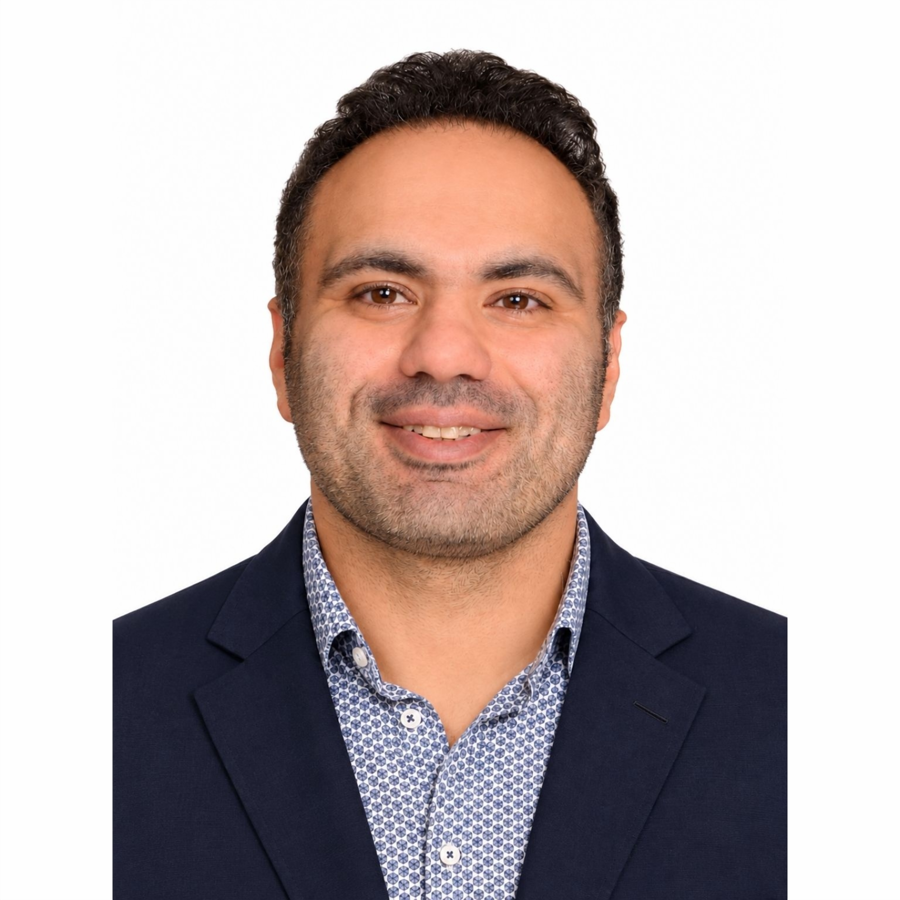

::: {.home-wrap}

::: {.hero}

::: {.person-panel}

::: {.profile-photo-frame}
{.profile-photo fig-alt="Photo of Hamed F. Ganji"}
:::

### Hamed F. Ganji

PhD · EngD

Acoustics, Waves & Vibrations

[GitHub](https://github.com/HamedGanji){.button .button-outline} [Email](mailto:h.faghanpourganji@tue.nl){.button .button-outline} [Google Scholar](https://scholar.google.com/citations?user=QPmfwzwAAAAJ&hl=en){.button .button-outline} 
[Linkedin](https://www.linkedin.com/in/hamed-f-ganji-684522166){.button .button-outline}

:::

::: {.hero-copy}

# My Work in Research and Engineering

My work combines physics-based modelling and system identification to develop digital twins of acoustic and vibration systems, enabling accurate predictions and effective engineering solutions. My work spans a range of applications, as described in my [projects](projects.qmd). I also use and contribute to open-source software to bridge research and engineering practice.

Alongside my research activities, I apply [systems engineering & architecture](approach.qmd#systems-engineering-and-architecture) principles and [Agile methodologies](approach.qmd#agile-methodology) to lead multidisciplinary teams and manage industrial projects. My approach emphasises effective collaboration, structured problem-solving, and delivering high-quality outcomes for clients and public stakeholders.
:::

:::

::: {.home-section}

## Active projects

::: {.feature-grid}

::: {.feature-tile}
### QuieterRail stakeholder research

A European industry survey and interviews inform the requirements for onboard rail roughness monitoring.

[Stakeholder research](projects.qmd#quieterrail-stakeholder-research)
:::

::: {.feature-tile}
### Onboard rail roughness monitoring

Technical guidance for measuring rail roughness acoustically from trains across European networks.

[Monitoring guidance](projects.qmd#quieterrail-monitoring-guidance)
:::

::: {.feature-tile}
### Rail roughness Python toolbox

Open-source software to support implementation of onboard rail roughness monitoring.

[Python toolbox](projects.qmd#quieterrail-python-toolbox)
:::

:::

:::

::: {.home-section .spotlight-section}

## Spotlight

**QuieterRail (ongoing):** I contribute to Work Package 3 of the [QuieterRail project](https://cordis.europa.eu/project/id/101176865), a Horizon Europe project under the Europe's Rail programme, a collaboration of sixteen industrial and academic partners. My work focuses on developing technical guidelines and open-source software for onboard acoustic monitoring of rail roughness, supporting more effective rail grinding.

**Hoogendoorn Award (2025):** I am happy to share that my PhD thesis received the [2025 KIVI Hoogendoorn Fluid Mechanics Award](https://www.tudelft.nl/2026/jm-burgerscentrum/kivi-hoogendoorn-fluid-mechanics-award-2025), given for the best PhD thesis defended in the 2024–2025 academic year. I am grateful for this recognition and thank everyone who supported me along the way.

**Farid Award (2022):** I was honoured to receive the Farid Award, established in memory of Dr. Farid Hosseinizadeh, an assistant professor at Babol Noshirvani University of Technology who passed away far too young. The award recognises promising early-career researchers. It is especially meaningful to me because it was granted by my hometown university.

:::

::: {.home-section .latest-posts-section}

## Latest Posts

::: {#latest-posts-listing}
:::

[All posts](posts/index.qmd)

:::

:::
