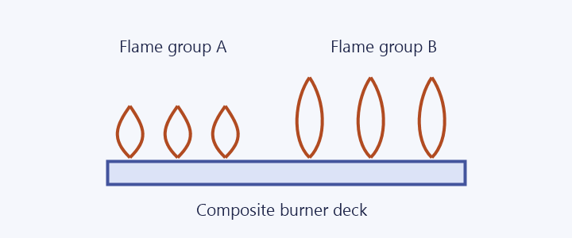
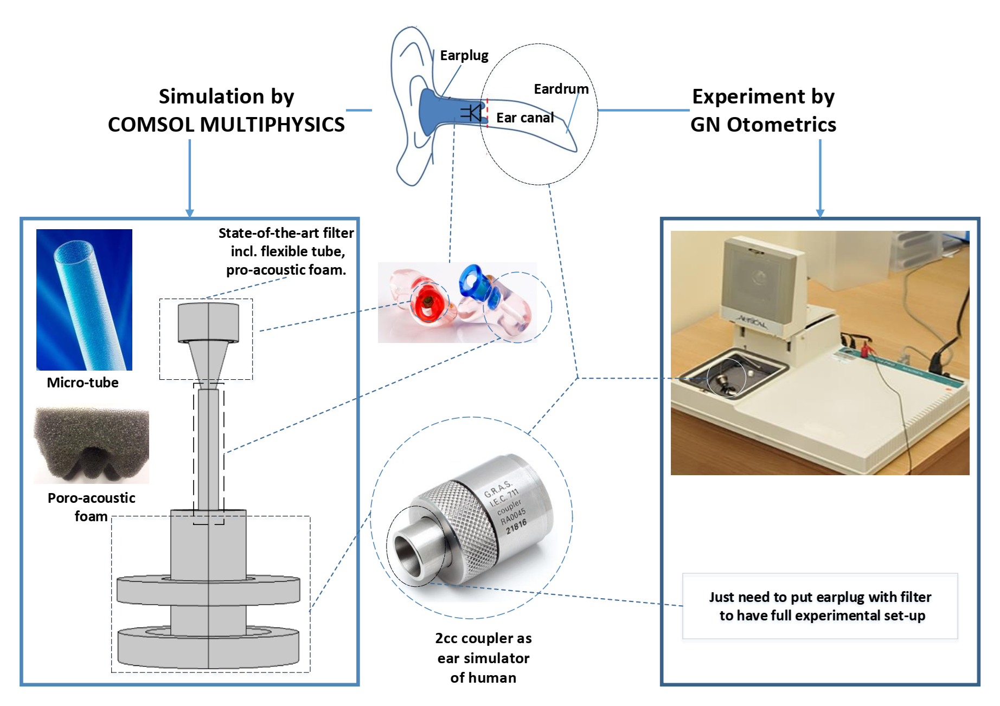
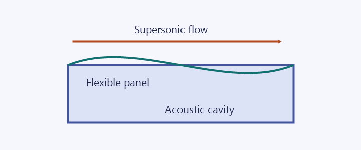
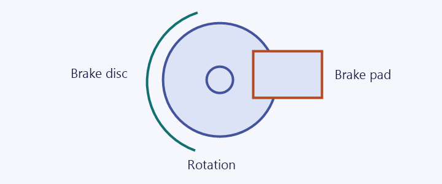
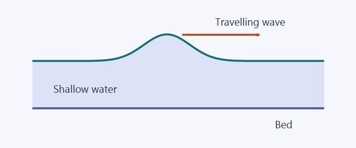

### PhD · Burner development and thermoacoustic instability

I investigated how to improve thermoacoustic stability by combining flame groups with different acoustic responses on a single burner deck. The model represents the composite flame transfer function as a weighted sum of the individual responses. I used the Direct Conservative Stability criterion to identify stable gain and phase ranges, then assessed robustness using stability margins and Monte Carlo uncertainty analysis.

{fig-alt="Two groups of differently sized flames on a common burner deck"}

[Read the PhD thesis](https://research.tue.nl/p/en/research-outputs/burner-development-strategies-in-the-context-of-thermoacoustic-in)

### Flat-spectrum filters for custom hearing protection

I designed and tested a passive acoustic filter for 3D-printed custom earplugs, aiming for more even attenuation across frequencies. I modelled the filter, earplug, ear canal and eardrum in COMSOL Multiphysics, then used acoustic foam to counteract a resonance introduced by the flexible tube. I built multiple prototypes and validated their performance with a GN Otometrics measurement setup.

{fig-alt="Incoming sound passes through an acoustic filter and ear canal toward the eardrum"}

[Read the PDEng thesis](https://research.utwente.nl/en/publications/development-of-a-flat-spectrum-filter-for-3d-printed-custom-made-/)

### Aero-vibroacoustics of a plate–cavity system

I studied how a flexible panel over an acoustic cavity responds to supersonic flow before and after flutter. I coupled a nonlinear panel model based on von Kármán plate theory to a modal model of the cavity. Time-domain simulations examined how turbulent boundary-layer excitation and external noise affect panel stability, limit-cycle oscillations and sound transmission loss. A related study investigated higher-order piston theory for panel flutter at low supersonic speeds.

{fig-alt="Supersonic flow travels over a flexible panel forming the top of an acoustic cavity"}

[Read the plate–cavity paper](https://arc.aiaa.org/doi/abs/10.2514/1.C034309)

### Linear and nonlinear analysis of brake squeal

I used a minimal disc-brake model to investigate how friction between the pad and the rotating disc affects stability. A linear analysis captured the effect of friction using a Stribeck model, and a nonlinear time-domain analysis estimated the amplitude and frequency of the disc's wobbling motion during braking.

{fig-alt="A brake pad contacts the edge of a rotating brake disc"}

[Read the brake dynamics paper](https://aip.scitation.org/doi/10.1063/1.4979609)

### Analytical modelling of shallow-water waves

In this team project, I studied travelling waves in the Jaulent–Miodek and coupled Whitham–Broer–Kaup equations. I applied the Differential Transformation Method (DTM) and Reduced Differential Transformation Method (RDTM) to obtain analytical solutions.

{fig-alt="A surface wave moves to the right above a flat bed"}

[Read the travelling-wave paper](https://www.sciencedirect.com/science/article/pii/S1110016816300680)
